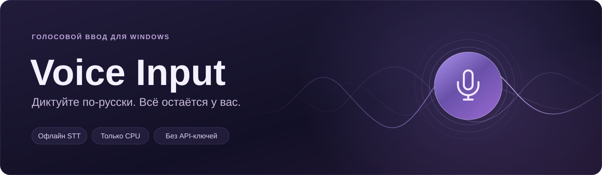
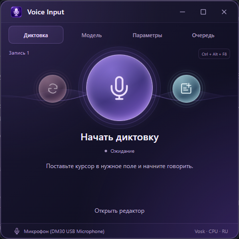
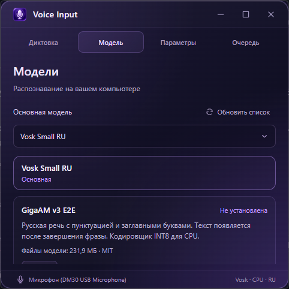
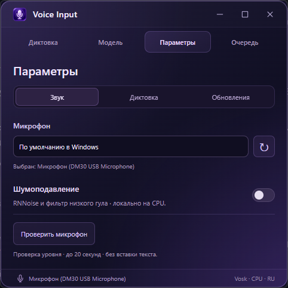
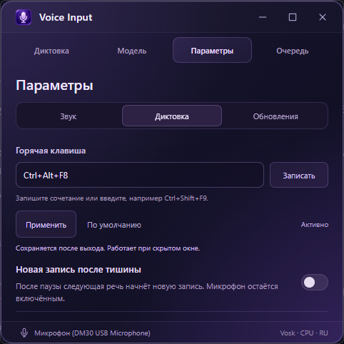
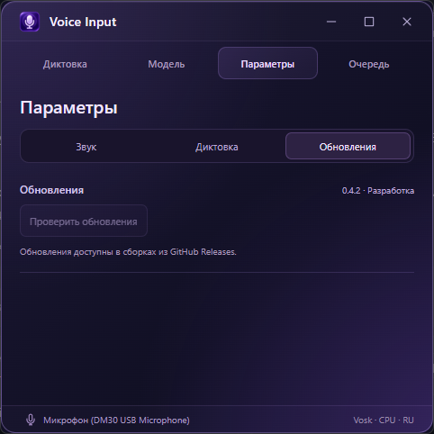
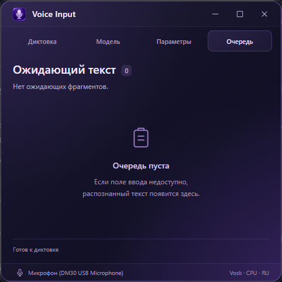

  

  
  
  
  
  
  

  <strong>Говорите — текст появляется в нужном поле.</strong> 
  Без облачного STT, видеокарты, VPN и API-ключей.

  <a href="https://github.com/Lotargo/voice-input/releases/latest/download/Voice-Input-Setup-windows-x64.exe"><strong>Скачать установщик</strong></a>
  &nbsp; · &nbsp;
  <a href="https://github.com/Lotargo/voice-input/releases/latest/download/Voice-Input-Portable-windows-x64.zip"><strong>Portable ZIP</strong></a>
  &nbsp; · &nbsp;
  <a href="#модели">Модели</a>
  &nbsp; · &nbsp;
  <a href="docs/manual.md">Руководство</a>
  &nbsp; · &nbsp;
  <a href="#поддержать-проект">Поддержать</a>

---

Voice Input — голосовой ввод на русском языке для Windows. Поставьте курсор в браузере, редакторе или чате, включите диктовку и говорите. Распознавание выполняется на вашем компьютере; отправка сообщения остаётся за вами.

> **Последний выпуск — [0.4.1](https://github.com/Lotargo/voice-input/releases/tag/v0.4.1).** В ветке `main` готовится `0.4.2`: устранены дубли Vosk, закрыт выбор произвольных моделей и выровнены разделы настроек. Скриншоты ниже показывают эту версию интерфейса.

## Почему Voice Input

| 🎙 Диктуйте в привычных приложениях | 🔒 Обработка на вашем ПК | 🧩 Выбирайте модель |
| --- | --- | --- |
| Финальные фразы поступают в активное редактируемое поле. Если поле недоступно, текст остаётся в очереди. | Аудио и записи не отправляются в облачный STT. Для распознавания достаточно CPU. | Vosk Small RU входит в пакет. GigaAM и Nemotron устанавливаются отдельно из каталога. |

- **Компактное окно.** Свежий текст виден внизу, предыдущие строки доступны прокруткой. Полный редактор открывается по желанию.
- **Записи и правки.** Паузы добавляют новые строки; запись можно очистить или начать следующую без остановки микрофона. Ручные правки сохраняются.
- **Контроль звука.** Выбор микрофона, проверка уровня и необязательное локальное шумоподавление. При потере устройства приложение останавливает захват.
- **Управление с клавиатуры.** Настраиваемая горячая клавиша, работа из трея и навигация по вкладкам.
- **Ручные обновления.** Подписанные пакеты для установленной и portable-версии. Фоновых проверок обновлений нет.
- **Общий каталог в AppData.** Установленная и portable-версия используют одни скачанные модели и настройки. Их можно сохранить при удалении приложения и подхватить при следующем запуске.

**Приложение не нажимает Enter и не отправляет сообщения автоматически.** Буфер обмена меняется только по кнопке «Копировать».

## Интерфейс

<table>
  <tr>
    <td align="center"><strong>Компактная диктовка</strong> </td>
    <td align="center"><strong>Каталог моделей</strong> </td>
  </tr>
  <tr>
    <td align="center"><strong>Звук</strong> </td>
    <td align="center"><strong>Диктовка и горячая клавиша</strong> </td>
  </tr>
  <tr>
    <td align="center"><strong>Обновления по вашей команде</strong> </td>
    <td align="center"><strong>Ожидающий текст</strong> </td>
  </tr>
</table>

На скриншотах показана настроенная клавиша `Ctrl + Alt + F8`; по умолчанию используется `Ctrl + Alt + Space`. Панель обновлений снята в режиме разработки: в сборках из GitHub Releases доступна ручная проверка обновлений.

## Начать за минуту

1. Скачайте **[установщик](https://github.com/Lotargo/voice-input/releases/latest/download/Voice-Input-Setup-windows-x64.exe)** или **[portable](https://github.com/Lotargo/voice-input/releases/latest/download/Voice-Input-Portable-windows-x64.zip)**. Portable нужно распаковать целиком, сохранив папку `Voice-Input`.
2. Запустите приложение. При необходимости выберите микрофон в **«Параметры → Звук»**.
3. Поставьте курсор в поле ввода и нажмите **Ctrl + Alt + Space**. Повторное нажатие остановит диктовку.
4. Проверьте распознанный текст и отправьте сообщение самостоятельно.

Если подходящего поля нет, фразы сохраняются в **«Очереди»**. Их можно скопировать вручную; необязательная вставка при наведении включается в настройках диктовки.

**Нужно:** Windows 10/11 x64, микрофон и Microsoft Edge WebView2 Runtime. Python, Node.js и GPU для работы приложения не требуются. Интернет нужен для скачивания дополнительных моделей и обновлений, которые запускаются вручную.

## Модели

| Модель | Размер дополнительных файлов | Как появляется текст |
| --- | ---: | --- |
| **Vosk Small RU** | Входит в пакет | Предварительный текст во время речи, без пунктуации |
| **GigaAM v3 E2E** | **231,9 МБ** | Русский текст с пунктуацией и регистром после завершения фразы |
| **Nemotron 3.5 ASR** | **682,2 МБ** | Потоковая диктовка с предварительным текстом и пунктуацией |

Используются CPU-экспорты **INT8**: у GigaAM квантован основной кодировщик, у Nemotron — также декодировщик и joiner.

Загрузку можно поставить на паузу, продолжить после обрыва или закрытия приложения либо отменить. После скачивания виден отдельный этап **«Проверка файлов»**. Только проверенная модель становится доступной для выбора. Скачанные модели и настройки сохраняются при обновлении.

В `main` выбор ограничен встроенной моделью и каталогом. Если в старых настройках была указана своя папка, потребуется явно выбрать поддерживаемую модель; её файлы приложение не удаляет.

> Модели могут ошибаться в словах, пунктуации и числах. Технические значения проверяйте вручную. [Результаты наших проверок](docs/qa/recognition-performance-2026-11-15.md) включают и обнаруженные ошибки.

## Руководство и разработка

| Что нужно | Где читать |
| --- | --- |
| Записи, ручная правка, очередь и настройки | [Подробное руководство](docs/manual.md) |
| Сборка из исходников, архитектура и локальные проверки | [Разделы руководства](docs/manual.md#быстрый-старт-из-исходников) |
| Подписи, пакеты и ручные релизы | [Порядок выпуска](releases/README.md) |
| Проверки релиза 0.4.1 | [Отчёт](docs/qa/release-0.4.1-2026-11-15.md) |
| Ошибка или предложение | [GitHub Issues](https://github.com/Lotargo/voice-input/issues) |

Ввод через Windows UI Automation зависит от редактора. Нестандартные или запущенные с повышенными правами приложения могут не принимать автовставку; в этом случае используйте очередь и ручное копирование.

Записи и правки хранятся в оперативной памяти. Перед закрытием или обновлением скопируйте нужный текст.

## Поддержать проект

Если Voice Input оказался полезен и хочется отблагодарить за разработку, можно перевести любую удобную сумму в **ЮMoney**.

**Кошелёк:** `4100 1151 9523 9085`

На странице перевода укажите номер кошелька выше. Поддержка добровольная. Спасибо всем, кто помогает проекту переводами, отзывами и сообщениями об ошибках 💜

## Сторонние компоненты и лицензия

Voice Input использует Tauri, Vosk, sherpa-onnx, ONNX Runtime и другие сторонние компоненты. Их лицензии и сведения о моделях приведены в [руководстве](docs/manual.md#сторонние-компоненты-и-лицензия) и поставляемых уведомлениях.

Исходный код Voice Input распространяется по лицензии **[MIT](LICENSE)**. Лицензии сторонних библиотек и моделей сохраняют свои условия; MIT для кода приложения их не заменяет.
